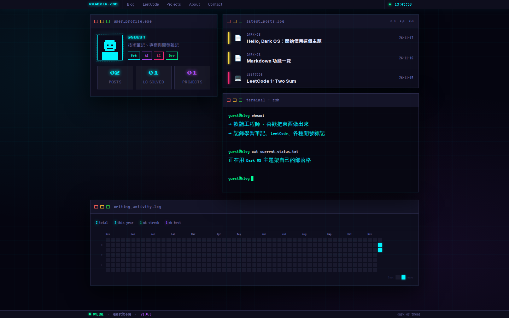

# Dark OS — Next.js Blog Template

把部落格做成復古作業系統桌面的 Next.js 主題：每個頁面都是一個視窗，首頁有可以打字的終端機，底部有工作列，配色是深色底加霓虹色。

*A retro "operating system" blog theme for Next.js 15 — windows, an interactive terminal, a taskbar and a neon palette.*



## 功能

- **Markdown 寫文章**：frontmatter 由 Zod 檢查，格式錯誤會在 build 時就報錯
- **程式碼**：語法高亮、行號、複製按鈕
- **數學式**：KaTeX（`$行內$`、`$$區塊$$`）
- **提示框**：GitHub 風格的 `> [!NOTE]`、`[!TIP]`、`[!WARNING]`、`[!IMPORTANT]`、`[!CAUTION]`
- **系列文章**：frontmatter 填 `series`，同系列的文章會自動串起來
- **LeetCode 區**：`/leetcode` 獨立列表，依難度和標籤篩選
- **專案頁**：`/projects`，內容寫在 `_projects/*.md`
- **版本紀錄**：`/changelog`，畫成 `git log` 的樣子
- **⌘K / Ctrl+K 搜尋**、**RSS**（`/feed.xml`）、**sitemap**、**每篇文章自動產生 OG 分享圖**
- **寫作熱度圖**：首頁顯示一年內的發文紀錄
- **Giscus 留言**（選用）、**聯絡表單**（選用，用 Resend 寄信）

## 開始使用

在 GitHub 上按 **Use this template → Create a new repository**，或直接 clone：

```bash
git clone https://github.com/YuunJiee/blog-template-dark-os.git my-blog
cd my-blog
npm install
npm run dev
```

打開 <http://localhost:3000>。

## 要改的檔案

| 檔案 | 內容 |
|---|---|
| `src/config/site.ts` | 網站名稱、網址、作者、終端機顯示的文字、首頁標籤、Giscus |
| `src/data/about.ts` | 關於頁：基本資料、經歷、技能、獲獎 |
| `public/images/avatar.svg` | 大頭貼。換成 png 的話，記得同時改 `site.ts` 的 `author.avatar` |
| `src/app/icon.svg` | 網站圖示 |
| `_posts/` | 文章（範例文章可以直接刪掉） |
| `_projects/` | 專案 |
| `_changelog/` | 版本紀錄 |

配色在 `src/app/globals.css` 的 `--neon-*` 變數。

### 新增文章

```bash
cp _templates/blog-post.md _posts/my-post.md       # 一般文章
cp _templates/leetcode-post.md _posts/lc-1.md      # LeetCode 題解
```

`draft: true` 的文章在正式環境不會出現。

### 留言（選用）

到 <https://giscus.app> 取得設定值，填進 `site.ts` 的 `giscus`。保持 `null` 就不會顯示留言區。

### 聯絡表單（選用）

複製 `.env.example` 成 `.env.local`，填入 [Resend](https://resend.com) 的 API key 和收件信箱。沒設定的話，表單會顯示「尚未設定」，不會報錯。

## 部署

**Vercel**：匯入這個 repo，設定環境變數 `NEXT_PUBLIC_SITE_URL`（你的網址，結尾不要加 `/`）即可。

**Docker**：

```bash
docker build -t dark-os-blog --build-arg NEXT_PUBLIC_SITE_URL=https://your-domain.com .
docker compose up -d
```

## 技術

Next.js 15（App Router）· React 19 · TypeScript · Tailwind CSS v4 · remark / rehype · Zod

字體：[Press Start 2P](https://fonts.google.com/specimen/Press+Start+2P)、[VT323](https://fonts.google.com/specimen/VT323)、[Noto Sans TC](https://fonts.google.com/noto/specimen/Noto+Sans+TC)、[Inter](https://fonts.google.com/specimen/Inter)，皆為 SIL Open Font License。

## 授權

MIT
